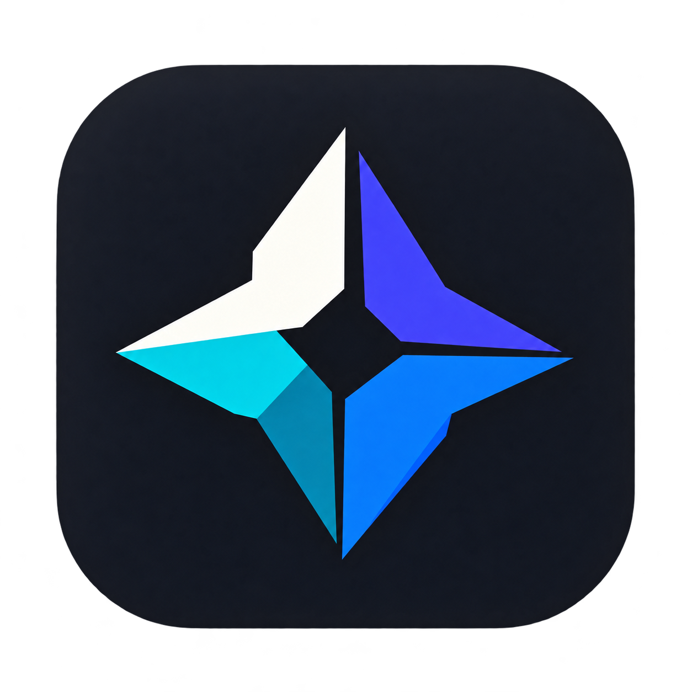

# Kaleid

<p align="center">
  
</p>

<p align="center"><strong>把图片、音乐、视频、小说和漫画放进同一个媒体库。</strong></p>

<p align="center">
  
  
  <a href="LICENSE"></a>
</p>

<p align="center">
  <a href="#features">功能</a> ·
  <a href="#installation">下载安装</a> ·
  <a href="#start">快速上手</a> ·
  <a href="docs/source-api.md">漫画与小说源 API</a> ·
  <a href="#credits">致谢与许可</a>
</p>

Kaleid 是面向 Windows 的本地优先多媒体浏览器。可以浏览自己的媒体文件，也可以按需配置在线音乐服务、漫画源和小说源，在统一界面中播放、阅读与管理收藏。

当前处于预览阶段，发行目标为 **Windows x64**。

<a id="features"></a>

## 功能

### 媒体库与浏览

- 按图片、音乐、视频、小说、漫画建立媒体库，添加多个文件夹，扫描并监听文件变化。
- 墙面、空间网格、标准网格、封面流等浏览布局；图片可使用等高、等宽画廊，小说和漫画可使用立体书架。
- 搜索、排序、收藏、历史记录，以及各媒体类型独立的浏览位置。
- 深色与浅色主题、导航位置、自动隐藏导航和减少动态效果设置。

### 图片

浏览本地图片、放大查看和切换图片，按文件夹组织内容，并在画廊或墙面中快速定位。

### 音乐

- 本地音乐、播放队列、歌单与播放会话恢复。
- 歌词、动态歌词样式和背景，桌面歌词与迷你播放控制。
- 十段均衡器、响度统一、音效、睡眠定时及输出设备选择。
- 可按需连接网易云音乐、QQ 音乐和 YouTube Music；实际内容、音质与登录能力取决于平台和账号权限。

### 视频

- 基于 mpv 的本地播放，支持音轨、字幕、播放速度、画面比例与进度恢复。
- 画中画；可设置离开播放页后是否自动进入画中画。
- 截取视频片段，导出 MP4 或 GIF。
- 可选通用超分和 NVIDIA RTX 处理，实际可用性取决于硬件、驱动与视频格式。

### 小说

- 本地 TXT、EPUB 阅读，支持目录、书签、进度和排版设置。
- 通过独立 JavaScript 书源使用搜索、最新、热门、作品详情与目录，功能按来源能力显示。
- 书架、稍后阅读、追更、历史和章节离线下载。
- 支持来源提供的账号登录、API 节点设置和原生 EPUB 导出。

### 漫画

- 阅读图片目录、CBZ / ZIP、CBR / RAR 和 7z / CB7。
- 单页、双页、纵向条漫、缩放、章节切换、缩略图、书签与继续阅读。
- 本地作品与章节整理，识别部分 ComicInfo.xml 元数据。
- 通过 Venera 兼容 JavaScript 源使用搜索、探索、分类、收藏、登录和下载，具体能力由脚本决定。
- 漫画源独立管理、批量导入、检查更新，以及按来源设置搜索语言筛选。

<a id="installation"></a>

## 下载安装

在本仓库的 [Releases](https://github.com/Teriss/Kaleid/releases) 中选择 Windows x64 安装包 `Kaleid-…-Setup.exe`，运行安装程序。升级时使用新版本安装包。

本地文件保留在用户选定的文件夹中；应用的索引、设置、收藏、阅读进度和缓存保存在用户数据目录。下载内容保存在应用中设置的下载目录。

<a id="start"></a>

## 快速上手

1. 创建媒体库，选择媒体类型并添加文件夹。
2. 选择喜欢的布局，打开媒体开始播放或阅读。
3. 在设置中调整外观、阅读偏好和播放行为。
4. 需要在线内容时，再进入对应的音乐账号或漫画、小说源管理入口进行配置。

### 配置漫画与小说源

应用不预装站点源，不预填或推荐源仓库。

请阅读 [漫画、小说源配置与 API](docs/source-api.md)，其中包含：

- 漫画和小说源的安装、启用、账号与 API 节点配置。
- Venera 兼容漫画源、Kaleid NovelSource API v1 的最小示例。
- 网络请求、设置、登录、章节和仓库索引的接口说明。

### 使用范围

当前提供 Windows x64 版本；不将 macOS、Linux 或其他架构列为已支持平台。小说暂不支持 DRM 保护的 EPUB；漫画暂不支持 PDF、加密或分卷压缩包。

在线内容由用户配置的服务提供，站点变化可能影响搜索、登录和加载。Kaleid 不附带小说正文、漫画图片或站点源脚本。

<details>
<summary>从源码运行与打包</summary>

需要 Windows x64、Node.js 24 和 .NET 10 SDK。在项目根目录执行：

```powershell
npm ci
npm run dev
```

构建安装包：

```powershell
npm run dist
```

首次开发或构建会联网准备固定版本的漫画、视频运行组件。安装包输出到 `release/`，项目源码归档为 `artifacts/Kaleid-Source.zip`；发布安装包时应同时提供匹配的源码和第三方许可材料。

</details>

<a id="credits"></a>

## 致谢与许可

感谢以下项目及其贡献者：

- [Wenku8_Flutter](https://github.com/mikufoxxx/Wenku8_Flutter)：立体书架几何、抽取动画与惯性运动算法的参考和适配。
- [Folia Major](https://github.com/chthollyphile/folia-major)：音乐服务适配、歌词、视觉效果、音效及部分浏览布局算法。
- [Venera](https://github.com/venera-app/venera)：漫画扩展接口；当前兼容库直接取自其衍生项目 [Venera-Next](https://github.com/CyrilPeng/Venera-Next) 的固定版本。

Kaleid 自有代码以 **AGPL-3.0-only** 发布，完整文本见 [LICENSE](LICENSE)。引入和适配的第三方代码继续保留各自版权与许可证；GPLv3 与 AGPLv3 代码的组合按两者第 13 条处理，不能将所有上游文件统一改标为自有代码。

随附的 EhTagTranslation 标签翻译数据另按 **CC BY-NC-SA 3.0 CN** 授权，不包含在代码的 AGPL 授权范围内。涉及该数据的再分发、修改或商业使用，应单独核对其条款。

固定版本、具体修改、数据许可和运行组件说明见 [THIRD_PARTY_NOTICES.md](THIRD_PARTY_NOTICES.md)。Kaleid 是独立项目，不代表上述项目的官方发行或背书。
